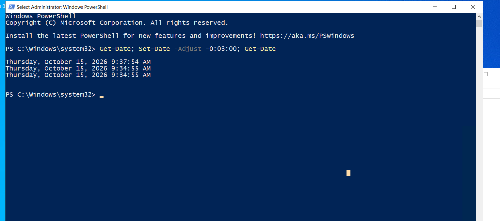
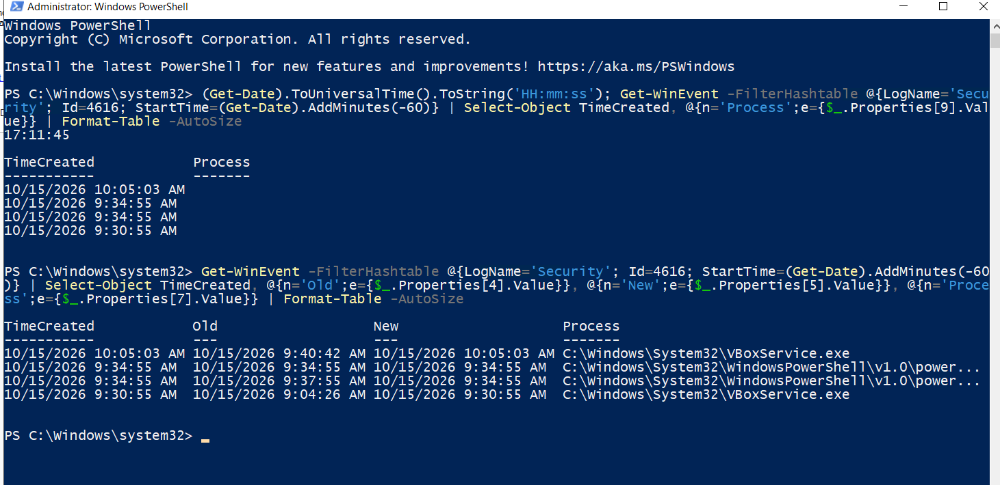

# Lab 02b - Detecting a DC Clock Change, and the Clock Changes Nobody Sees

## Objective
Lab 02 found that DC01's clock is wrong after some boots, and that mis-dated events fall
out of scheduled rules without any error. This lab asks the defender's question: **if
someone changes the domain controller's clock on purpose, does the SIEM say so?** The
answer has three parts: what the shipped Wazuh ruleset does, a custom rule that was
fired live, and the clock changes that never reach the SIEM at all.

**This lab runs in Wazuh, not Sentinel.** It is part of Module 10 because it follows
directly from Lab 02's time-integrity finding. No Azure resource is used.

## Framing
| Field | Value |
|---|---|
| Discipline | Detection engineering - time integrity, log-source coverage |
| ATT&CK | No exact technique for changing the system clock. Nearest: T1070.006 (Timestomp), which is about file timestamps - here the whole DC clock is skewed, so every event it logs is mis-dated, as Lab 02 measured |
| Signal | Windows Security event **4616** - "The system time was changed" (previous time, new time, process) |
| Engine | Wazuh 4.14.6, agent 004 on DC01 (Windows Server 2022, `lab.local`) |
| Rules | **101000** (L8), **101001** (L12) - new; shipped **60132** (L5) |
| Cost / subscription | None |

## Part 1 - What the shipped ruleset already does
The prediction was a coverage gap. **That prediction was wrong.** Shipped rule **60132**
("System time changed", level 5) matches event 4616. The problem is the opposite of a gap:
it fires all the time, and every alert is benign.

| Agent | 60132 alerts (history) | Process that changed the clock |
|---|---|---|
| DC01 (004) | 37 | `VBoxService.exe` |
| Windows endpoint (002) | 53 | `VBoxService.exe` |
| Windows endpoint (002) | 43 | `svchost.exe` (w32time) |
| **Total** | **133** | **0 suspicious** |

On DC01 the clock is never set by Windows Time. Every change is made by the VirtualBox
Guest Additions service. A level-5 rule that fires 133 times on two legitimate
processes teaches an analyst to ignore it. A real change would be lost in that noise.

Kernel-General event 1 (System channel) also records clock changes. No shipped rule
matches it, and on these hosts it records the same changes as 4616, so it adds no
extra coverage.

## Part 2 - Rules 101000 / 101001
Keep 60132 as the base and alert only when the process is **not** one of the two known
time sources. Raise the level again if the host is a domain controller.

```xml
<!-- Lab 02b: clock change by a process that is not a known time source.
     KNOWN EVASION: reconfiguring w32time to a rogue NTP source makes svchost.exe
     perform the change, which is excluded here. -->
<rule id="101000" level="8">
  <if_sid>60132</if_sid>
  <field name="win.eventdata.processName" type="pcre2" negate="yes">(?i)(^|\W)(vboxservice|svchost)\.exe$</field>
  <description>System time changed by unexpected process $(win.eventdata.processName) ($(win.eventdata.subjectUserName)) on $(win.system.computer)</description>
  <options>no_full_log</options>
  <group>time_changed,</group>
</rule>

<rule id="101001" level="12">
  <if_sid>101000</if_sid>
  <list field="win.system.computer" lookup="match_key">etc/lists/domain-controllers</list>
  <description>DOMAIN CONTROLLER clock changed by unexpected process $(win.eventdata.processName) ($(win.eventdata.subjectUserName)) on $(win.system.computer) - domain time authority, Kerberos and log timelines affected</description>
  <options>no_full_log</options>
  <group>time_changed,</group>
</rule>
```

- `etc/lists/domain-controllers` is the CDB list from Module 09 Lab 04 (`DC01.lab.local:dc`).
- Deployed by scp + md5 on both ends. `wazuh-analysisd -t` passed and the manager restarted cleanly.
- **Negative check (offline):** the rule condition was re-applied in Python to the 133
  historical 60132 alerts, and 0 would fire. This is a check of the regex, **not** a
  Wazuh evaluation. The live test is Part 3.

## Part 3 - Live-fire
From an RDP session on DC01 as the domain Administrator, in an elevated PowerShell:

```powershell
Get-Date; Set-Date -Adjust -0:03:00; Get-Date
```



The clock moved from 9:37:54 to 9:34:55 local time (3 minutes back).

| Manager time (UTC) | Rule | Level | Process | Previous time | New time |
|---|---|---|---|---|---|
| 16:38:15.614 | **101001** | **12** | `powershell.exe` (Administrator) | 16:37:55.0664 | 16:34:55.0420 |
| 16:38:15.638 | **101001** | **12** | `powershell.exe` (Administrator) | 16:34:55.0434 | 16:34:55.0420 |

- **True positive.** The rule fired on the first attempt at the intended level, and
  101001 (the DC rule) won over its parent 101000 as designed.
- **One command, two alerts.** `Set-Date` writes two 4616 events: the 3-minute step,
  then a correction of about 1.4 ms. Both match the rule.
- **The event is stamped with the forged time.** The 4616's own `systemTime` is
  16:34:55, but the manager received it at 16:38:15. An analyst who sorts by event time
  places the attack 3 minutes before it happened. The attack falsifies the timestamp of
  the event that reports it.
- Delivery took about 20 s. The DC and manager clocks are not synchronised, so this is
  approximate.

## Part 4 - The clock changes that never arrive
The plan was for VirtualBox to put the clock back, raising 60132 (VBoxService, allowed)
and **not** 101001: a built-in negative control. **60132 never fired.** DC01's own
Security log, read on the DC, shows why:



| DC01 time (local) | Previous -> new | Process | Cause | Reached Wazuh? |
|---|---|---|---|---|
| 9:30:55 | 9:04:26 -> 9:30:55 (**+26.5 min**) | `VBoxService.exe` | Clock set during boot, after a hard reset | **No** - agent started 23 s later |
| 9:34:55 (x2) | 9:37:55 -> 9:34:55 | `powershell.exe` | The live-fire | Yes - 101001 x2 |
| *(none)* | 3 min behind -> correct | VirtualBox | Gradual correction after the live-fire | **Nothing logged on DC01** |
| 10:05:03 | 9:40:42 -> 10:05:03 (**+24.4 min**) | `VBoxService.exe` | Clock set during boot, after a hard reset | **No** - agent started 24 s later |

### Finding 4a - The correction is silent at the source
For 26 minutes after the live-fire, DC01 logged **no** 4616. An NTP query from the host
6 minutes after the change showed the DC about 41 s off and closing by roughly 0.5 s per
second (two samples). VirtualBox **slewed** the clock back gradually instead of stepping
it. A slewed clock produces no "time changed" event at all.

This means the SIEM shows when a clock was moved, but not when it became correct
again. **The length of the bad-timestamp window cannot be measured from events.**

### Finding 4b - Boot-time clock changes are invisible to Wazuh
Both cold boots logged a large VBoxService clock step about 24 s **before** the Wazuh
agent started. Neither reached the manager: 0 x 60132 for either boot. The Wazuh
`localfile` option `only-future-events` defaults to `yes` for `eventchannel`, which
skips events written while the agent was not running. That is the likely mechanism;
setting it to `no` on the Security channel was **not tested**.

This corrects a note from the start of this lab, where "a cold boot raised no 60132"
was read as "a cold boot does not change the clock". It does, by up to 26 minutes here.
The change is logged, but never delivered. It also matches Lab 02: the 21 mis-dated
Kerberos events were all logged in the seconds after a DC01 boot, before the clock was
corrected.

### Finding 4c - Why the clock was 25 minutes behind
Both boots followed a period when the host ran out of RAM. DC01 was paged down to
163-1,400 MB of its 3 GB, used a full CPU core, stopped sending events and could not
complete an RDP login. A starved VM's clock falls behind. In the first case the boot-time
"previous" value (16:04 UTC) lines up with the agent going silent (16:06). In the second
case it does not line up exactly; the clock may have run slow before it stopped. That
was not measured.

The historical VBoxService 60132 alerts are probably clock steps after resuming from a
saved state, when the agent is already running. This is consistent with what was seen
here, but not proven.

## Test matrix
| # | Action | Expected | Observed | Result |
|---|---|---|---|---|
| 1 | History: 133 benign 60132 alerts, condition re-applied offline | 0 x 101000 | 0 | Pass (regex check only) |
| 2 | `Set-Date -Adjust -0:03:00` on DC01 as Administrator | 101001 L12 | 101001 L12 x2 | **Pass** (duplicate alert) |
| 3 | VirtualBox corrects the 3-min skew | 60132 only | No event at all (slew) | **Not testable - no event exists** |
| 4 | Cold boot after RAM starvation (x2) | 60132 only | 4616 logged on DC, never delivered | **Collection gap** |
| 5 | Change by `svchost.exe` (rogue NTP) | Not detected (known evasion) | Not run | Not run |
| 6 | Same change on a non-DC | 101000 L8, not 101001 | Not run | Not run |

## Findings
1. **The gap was noise, not missing coverage.** The shipped rule covers 4616, but 133
   benign alerts from two expected processes bury it. An allow-list by process turns it
   into a level-12 DC alert that fired on the first live attempt.
2. **A clock-change alert carries the forged time.** Investigate with the manager's
   receive time (or Sentinel's `ingestion_time()`), not the event's own timestamp.
3. **Expect two alerts per change.** Wazuh's `ignore` attribute on 101001 (for example
   `ignore="60"`) would suppress the duplicate. Not tested.
4. **The repair is invisible.** A slewed correction writes no 4616. Time integrity cannot
   be monitored from 4616 alone; it needs an independent comparison (for example, a
   scheduled offset check against a reference clock).
5. **Boot-time steps are never collected.** With the default `only-future-events`, a
   clock change made before the agent starts never reaches the SIEM. On a DC, that is
   exactly when Lab 02's mis-dated events were written.
6. **Lab instability is a time-integrity finding in its own right.** Host memory
   starvation pushed the DC's clock 25 minutes behind, twice in one session.

## Known limitations
- **One live attempt.** Rows 5 and 6 of the matrix were not run.
- **The slew observation rests on two NTP samples**. Later NTP queries timed out. The
  correction rate is approximate.
- **Mechanism for Finding 5 is from documentation**; `only-future-events no` was not tested.
- **Lab environment.** The DC's time source is VirtualBox Guest Additions, not an NTP
  hierarchy. A physical or properly configured DC would not see the 25-minute boot steps,
  but the collection gap (Finding 5) does not depend on the cause of the change.
- The positive test used the DC's own Administrator account. An attacker would need
  `SeSystemtimePrivilege` (administrators and LOCAL SERVICE by default).

## Files
- Rules: inline above. Deployed to `/var/ossec/etc/rules/local_rules.xml` on the manager.
- Screenshots: [`11-Screenshots/10-Sentinel-KQL/`](../11-Screenshots/10-Sentinel-KQL/) (`Lab02b-*`)
